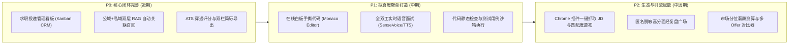

# MindForge AI（心铸智聘）

<p align="center">
  
  
  
  
  
  
  
  
  
</p>

> **MindForge AI** 是一套面向现代互联网求职全生命周期的**企业级 AI 智能求职赋能系统**。  
> 平台深度融合大语言模型（LLM）与检索增强生成（RAG）技术，集**简历深度结构化解析与定向诊断、目标职位 JD 穿透拆解与五维匹配、全真 AI 模拟面试与四维能力复盘报告、公域官方智库与私域个人知识库问答**于一体，提供从“能力评估、简历优化、全真模拟、实时复盘到知识汲取”的端到端求职提效全流程闭环。

---

## 目录

- [一、 系统核心架构与设计哲学](#一-系统核心架构与设计哲学)
- [二、 技术全景速览](#二-技术全景速览)
- [三、 核心功能特性](#三-核心功能特性)
- [四、 本地开发与部署指引](#四-本地开发与部署指引)
  - [1. 环境依赖前置要求](#1-环境依赖前置要求)
  - [2. 数据库与中间件初始化](#2-数据库与中间件初始化)
  - [3. 启动 Java 业务主服务](#3-启动-java-业务主服务)
  - [4. 启动 Python AI 微服务](#4-启动-python-ai-微服务)
  - [5. 启动 Vue 前端应用（一仓两端）](#5-启动-vue-前端应用一仓两端)
- [五、 核心接口与服务契约规范](#五-核心接口与服务契约规范)
- [六、 生产级避坑指南与工程规约](#六-生产级避坑指南与工程规约)
- [七、 未来演进与路线图 (Roadmap)](#七-未来演进与路线图-roadmap)

---

## 一、 系统核心架构与设计哲学

MindForge 采用**“业务与重计算解耦、双端隔离、前后端单仓协作”**的现代化分布式架构：

```
                              ┌────────────────────────────────────────┐
                              │            用户浏览器 Client            │
                              └───────┬────────────────────────┬───────┘
                                      │                        │
                    :5173 /           ▼                        ▼           :5174 /admin/
           ┌────────────────────────────────┐    ┌────────────────────────────────┐
           │   用户端前端 (User Portal)     │    │   管理端前端 (Admin Console)   │
           │   Vue 3 + TS + Element Plus    │    │   Vue 3 + TS + Element Plus    │
           └──────────────┬─────────────────┘    └────────────────┬───────────────┘
                          │                                       │
                          │   Vite Proxy: /api ──► :8080/api      │
                          └───────────────────┬───────────────────┘
                                              ▼
                    ┌──────────────────────────────────────────────────┐
                    │       Java 业务主后端 (Spring Boot 3.5.16)        │
                    │   • 账号鉴权与 RBAC (无状态双 Token 轮转安全防御)  │
                    │   • 知识库/文档元数据管理与预签名 OSS/MinIO 存取   │
                    │   • 对话会话状态机、简历与 JD 业务生命周期维护     │
                    │   • 面试流程编排、审计日志记录、限流与风控告警     │
                    └───────────▲──────────────────────────┬───────────┘
                                │                          │
                  分布式异步认领 │ FOR UPDATE               │ REST / SSE
         (POST /internal/claim) │ SKIP LOCKED              │ (带 X-Service-Token)
                                │                          ▼
                    ┌───────────┴──────────────────────────────────────┐
                    │         Python AI 微服务 (FastAPI / 3.12)        │
                    │   • 文档智能解析 (PDF/DOCX/TXT/MD/HTML 统一归一化)│
                    │   • 原生文本提取与爬虫清洗工具 (基于 trafilatura) │
                    │   • 文本智能分块 (Chunking) & 向量化嵌入管道     │
                    │   • SSE 逐字流式 RAG 对话 (首字响应低至 0.45s)   │
                    │   • 阿里百炼 Qwen-2.5/3.8 + Embedding-v1 驱动   │
                    └─────────────────────┬────────────────────────────┘
                                          │
            ┌─────────────────────────────┼─────────────────────────────┐
            ▼                             ▼                             ▼
   ┌─────────────────┐           ┌─────────────────┐           ┌─────────────────┐
   │    MySQL 8.0    │           │     Redis 7     │           │   对象存储/向量库 │
   │ 业务实体持久化  │           │ Token黑名单防重放│           │ MinIO/OSS +     │
   │ 乐观锁与状态机  │           │ 滑动窗口接口限流 │           │ Chroma/pgvector │
   └─────────────────┘           └─────────────────┘           └─────────────────┘
```

### 核心架构设计原则：
1. **硬性职责边界（数据权属在 Java，计算推理在 Python）**：
   - **Java 端**：拥有所有数据库直连权、事务控制、权限校验（RBAC）与对象存储持久化。绝不允许 Python 绕过 Java 直接查库或判断用户权限。
   - **Python 端**：定位为纯粹的高性能“无状态 AI 计算节点”，专注文本解析、特征提取、向量检索、Prompt 组装及大模型推理。
2. **异步队列去中心化（主动轮询认领取代重型 MQ）**：
   - 文档解析与向量化采用轻量可靠的 `DB FOR UPDATE SKIP LOCKED` 悲观锁认领机制；Python 节点主动拉取任务（Pull 模式），避免 NAT 网络穿越困难，天然具备背压（Back-pressure）防护能力。
3. **前端一仓两端（Monorepo Workspace）**：
   - 用户端（`:5173`）与管理端（`:5174`）位于同一个代码仓库中，通过 `@mindforge/shared` 包共享全部 TypeScript 类型契约、统一 API 请求客户端与 Token 刷新防并发重放逻辑，消灭多端契约漂移。
4. **流式体验极致优化**：
   - RAG 对话采用 `Server-Sent Events (SSE)` 全链路透传。优先下发检索引用来源（`sources`），随后逐字下发答案增量（`delta`），首字节时间从 8.7 秒压降至 0.45 秒。

---

## 二、 技术全景速览

| 维度 | 技术栈 / 核心组件 | 版本 / 选型理由 |
| :--- | :--- | :--- |
| **Java 业务端** | Spring Boot | `3.5.16`（底层基于 Spring 6.2，全面适配 Java 21 虚拟线程） |
| | 安全与鉴权 | `Spring Security 6.2` + `JJWT 0.12`（无状态 JWT、双 Token 轮转机制） |
| | ORM 与持久层 | `MyBatis-Plus 3.5.10` + `Druid 1.2` 动态连接池 |
| | 数据源与缓存 | `MySQL 8.0`（InnoDB UTF8MB4） + `Redis 7.x`（Lettuce 连接池） |
| | 接口文档 | `Knife4j / SpringDoc OpenAPI 3`（规范接口契约） |
| **Python AI 端** | 核心框架 | `FastAPI 0.115` + `Uvicorn`（异步高性能 ASGI 引擎） |
| | 大模型与向量 | `DashScope 阿里百炼`（Qwen 3.8 / 2.5 系列 + text-embedding-v1） |
| | 文档解析提取 | `pdfplumber` + `python-docx` + `BeautifulSoup4` + `trafilatura`（无 LangChain 依赖，轻量秒级启动） |
| | 向量计算 | 混合检索架构（向量空间余弦匹配 + Rerank 交叉精排打分） |
| **前端工程** | 架构方案 | `pnpm monorepo` 工作区架构（共享 `@mindforge/shared`） |
| | 核心框架 | `Vue 3.5` + `TypeScript 5.8` + `Vite 6` |
| | 状态与路由 | `Pinia 3.0` + `Vue Router 4.5`（HTML5 History 路由模式） |
| | UI 与图表 | `Element Plus 2.9`（按需自动引入）+ `ECharts 5.6`（动态监控仪表盘） |

---

## 三、 核心功能特性

### 1. 身份安全与细粒度 RBAC 权限体系
- **双端隔离登录**：支持普通求职者与管理员独立认证入口，采用统一 `sys_role`、`sys_permission` 资源码拦截。
- **无状态双 Token 防御**：短效 Access Token（30 分钟）+ 长效 Refresh Token（7 天）；支持 Token 轮转（Rotation）防重放探测，拦截异地异常刷新。
- **审计追踪与高危操作告警**：全自动记录操作人、耗时、IP 及资源 ID；危险操作（如批量删除文档、修改 AI 模型配置）自动捕获并生成管理员告警。

### 2. 多格式文档智能解析与自愈式向量化流水线
- **多类型混合解析**：支持 `PDF`、`DOCX`、`TXT`、`Markdown`、`HTML` 文件统一抽取为结构化 Markdown。
- **阶段状态解耦**：文档严格经历 `PARSING`（解析）➔ `CHUNKING`（分块）➔ `EMBEDDING`（向量化）三段状态，任何一步异常均记录详细错误栈，支持管理端一键人工重试。
- **脏向量闭环清理**：文档逻辑删除后，向量库并不产生孤儿碎片，后台自动化巡检并同步清理向量索引。

### 3. 全局官方智库建设与一键网页 URL 抓取入库
- **公域官方智库**：管理端专属通道，支持管理员建立全平台共享的官方智库（如《Java 2026 最新大厂面经》、《高频算法手撕宝典》）。
- **原生轻量正文提取器**：集成工业级网页抽取引擎，输入文章 URL 即可毫秒级剔除侧边栏、广告与版权，提取纯净 Markdown 并自动进入向量化队列。

### 4. 深度 RAG 对话检索与无门槛优雅降级
- **首字毫秒级 SSE**：建立流水线流式事件推流机制（`sources` ➔ `delta` ➔ `done` / `error`）。
- **零门槛自由对话**：用户无需强制绑定知识库，支持默认的“🤖 通用顾问”直接交互。
- **检索未命中优雅降级**：当私域知识库未检索到相关内容时，不再生硬阻断，而是自动切换为通用大模型专业解答，并附带明确的免责与来源标识。

### 5. 简历深度结构化解析与针对性优化建议
- **实体属性精准解构**：从杂乱的排版中自动抽取技能树、项目经历、量化成果指标。
- **针对目标岗位的改写诊断**：拒绝“凭空胡编”，系统在给出改进建议时，**严格区分“表达改写”与“缺失事实待补”**，防止候选人背诵虚构经历在面试中露馅。

### 6. 简历-JD 智能匹配矩阵（告别虚假百分比）
- 弃用无意义的单一百分比评分，提供**五类具象化结论**：
  - `已匹配`：有明确事实支撑的技能点；
  - `表达缺口`：做过但简历写得过于隐晦；
  - `证据不足`：提及名词但缺少项目佐证；
  - `真实缺口`：完全缺失的硬性任职资格；
  - `待确认`：模糊表述待用户补充。

### 7. 全真 AI 模拟面试与四维复盘报告
- **动态情境化出题**：综合候选人简历经历与目标岗位 JD，自动生成针对性追问（技术深挖、行为面试、架构设计）。
- **标准要点严格评分**：出题时预置参考要点（`expectedPoints`），防止评分因温度系数产生打分漂移。
- **四维复盘报告**：涵盖技术深度、逻辑清晰度、问题解决能力、沟通表达打分及逐题诊断。

---

## 四、 本地开发与部署指引

### 1. 环境依赖前置要求

确保本机已安装以下基础环境：
- **JDK**：`21` 及以上（推荐 OpenJDK 21 或 Temurin 21）
- **Node.js**：`v20.10.0` 及以上（包管理器使用 `pnpm 9+`）
- **Python**：`3.12` 及以上（推荐搭配 `uv` 或原生 `venv`）
- **MySQL**：`8.0+`
- **Redis**：`6.0+` 或 `7.x`

---

### 2. 数据库与中间件初始化

1. 启动本地 MySQL 服务，创建主数据库：
   ```sql
   CREATE DATABASE mindforge DEFAULT CHARACTER SET utf8mb4 COLLATE utf8mb4_0900_ai_ci;
   ```
2. 导入结构与种子初始化脚本：
   - 导入根目录提供的 [`mindforge-schema.sql`](./mindforge-schema.sql) 文件；
   - 脚本已内置系统预设角色（`USER`、`ADMIN`、`SUPER_ADMIN`）、权限项字典与预设测试账号：
     - **普通用户账号**：`zhangsan` / `test-123456`
     - **管理员账号**：`admin` / `admin123`（或使用测试用户 `t_admin` / `test-123456`）
3. 启动本地 Redis 服务（默认监听 `6379` 端口）。

---

### 3. 启动 Java 业务主服务

1. 进入 Java 工程根目录：
   ```bash
   cd d:\java_IDEA\maven_code\mindforge-ai
   ```
2. 检查 `src/main/resources/application-dev.yml` 配置：
   - 确认 MySQL 连接用户名密码（默认 `root / 123456`）；
   - 确认 Redis 地址及端口；
   - 确认对象存储配置（默认支持 `LOCAL` 本地文件目录，无需开通公网 OSS 即可运行）；
   - 确认内部服务通讯令牌 `mindforge.internal.service-token`（用于 Python 与 Java 相互鉴权）。
3. 编译并启动服务：
   ```bash
   # Windows PowerShell
   .\mvnw.cmd spring-boot:run
   ```
4. 验证服务状态：
   - 后端启动在 **`http://localhost:8080/api`**；
   - OpenAPI 接口文档地址：`http://localhost:8080/api/doc.html`。

---

### 4. 启动 Python AI 微服务

1. 进入 Python 工程目录：
   ```bash
   cd D:\pythoncode\mindforge-ai-service
   ```
2. 配置虚拟环境并安装依赖：
   ```bash
   # 使用 uv 极速安装（推荐）
   uv venv --python 3.12
   uv sync

   # 或者使用原生 pip
   python -m venv .venv
   .\.venv\Scripts\activate
   pip install -r requirements.txt
   ```
3. 环境变量配置：
   - 复制 `.env.example` 为 `.env`；
   - 核心配置项填入：
     ```env
     # Java 后端地址（必须带 context-path /api）
     JAVA_BASE_URL=http://localhost:8080/api
     JAVA_SERVICE_TOKEN=5oiQ55Ge56Wl5Zac5qyi5a2Z5Y2a5paH

     # 大模型配置（开箱即用支持阿里云百炼 API Key）
     DASHSCOPE_API_KEY=sk-xxxxxxxxxxxxxxxxxxxxxxxxxxxxxxxx
     CHAT_MODEL=qwen3.8-27b
     EMBEDDING_MODEL=text-embedding-v1

     # 自动轮询认领开关
     ENABLE_POLLER=true
     SERVICE_PORT=8000
     ```
4. 启动微服务：
   ```bash
   .venv\Scripts\python.exe -m uvicorn app.main:app --host 0.0.0.0 --port 8000 --reload
   ```
5. 验证通讯连通性：
   - 浏览器打开 `http://localhost:8000/health/java`，若返回 `{"status":"ok", ...}` 则表明已与 Java 成功握手。

---

### 5. 启动 Vue 前端应用（一仓两端）

1. 进入前端 Monorepo 目录：
   ```bash
   cd D:\Vue\mindforge
   ```
2. 启用 pnpm 并安装全部依赖：
   ```bash
   corepack enable pnpm
   pnpm install
   ```
3. 启动前端研发服务：
   ```bash
   # 启动用户端（用于日常求职、简历上传、模拟面试、知识库对话）
   pnpm dev:user
   # 访问地址：http://localhost:5173/

   # 启动管理端（用于全站监控、官方智库录入、文档运维、AI 模型配额管理）
   pnpm dev:admin
   # 访问地址：http://localhost:5174/admin/
   ```

> 💡 **代理说明**：前端的 `/api` 请求已分别配置在各自的 `vite.config.ts` 中代理转发至 `http://localhost:8080`，本地研发期间无需配置后端 CORS 跨域。

---

## 五、 核心接口与服务契约规范

### 1. 路由空间规范
- `/api/app/**`：面向普通求职者的业务接口（必须携带用户端 Access Token，经归属权隔离校验）。
- `/api/admin/**`：面向系统管理员与超级管理员的运营接口（必须具备 `ADMIN` 或 `SUPER_ADMIN` 角色）。
- `/api/internal/**`：供 Python AI 微服务反向调用 Java（不走用户 JWT，必须在 Header 中携带 `X-Service-Token`）。
- `/internal/ai/v1/**`：供 Java 调用 Python 计算引擎（必须在 Header 中携带 `X-Service-Token` 与链路追踪 `X-Trace-Id`）。

### 2. 流式问答 SSE 契约（`/internal/ai/v1/rag/chat/stream`）
流式连接返回标准的 `text/event-stream`，事件推流严格遵循下述拓扑时序：
```
event: sources   data: {"type":"sources","hasContext":true,"sources":[...]}
event: delta     data: {"type":"text","text":"Java "}
event: delta     data: {"type":"text","text":"内存模型"}
...
event: done      data: {"type":"answer","hasAnswer":true,"answer":"..."}
(异常分支)
event: error     data: {"type":"error","code":50202,"message":"..."}
```

---

## 六、 生产级避坑指南与工程规约

在项目长期演进过程中，总结沉淀了以下关键工程规约，请所有参与协作的开发者共同遵循：

1. **不可变集合与 `null` 穿透警惕**：
   - 严禁在含可空字段的上下文中盲目使用 Java 9 的 `Map.of()`（只要包含任意 null 键或值便会立即抛出 `NullPointerException` 导致系统崩溃）；涉及可选字段时必须使用 `new LinkedHashMap<>()`。
2. **Spring Security 异步派发（ASYNC Dispatch）通行放行**：
   - 对于 SSE 流式长连接或 `DeferredResult`，容器在写完响应后会以 `DispatcherType.ASYNC` 重新遍历过滤器链。必须在 `SecurityConfig` 中加入 `.dispatcherTypeMatchers(DispatcherType.ASYNC).permitAll()`，否则客户端会在流收尾时收到虚假的连接掐断异常（`AuthorizationDeniedException`）。
3. **前端 Long 型雪花 ID 精度保全**：
   - 数据库主键均为 64 位 Long 类型，向前端序列化时**必须统一转换为 String**，避免前端 JavaScript `Number.MAX_SAFE_INTEGER`（9007199254740991）截断末位产生隐蔽的 ID 漂移 Bug。
4. **同源部署 LocalStorage 前缀隔离**：
   - 用户端与管理端如处于同一域名端口下，其 LocalStorage 是完全共享的。所有缓存 Token 的 key 必须严格使用前缀（`mf_user_` 与 `mf_admin_`），杜绝相互顶号。

---

## 七、 未来演进与路线图 (Roadmap)

项目整体采用三阶段迭代推进，当前已完成基座搭建，后续演进方向如下：



详细功能说明与架构设计方案请参阅完整规划文档：[`ROADMAP.md`](file:///D:/Vue/mindforge/ROADMAP.md)。

---

## 开源协议

本项目基于 [MIT License](LICENSE) 协议发布，欢迎参与交流、提交 Issue 与 Pull Request。
