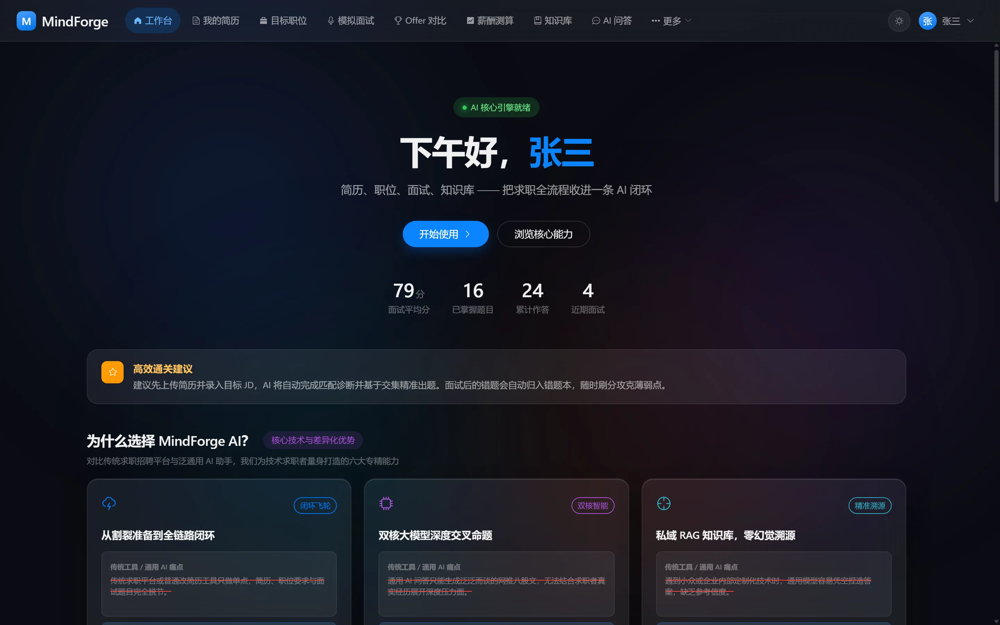
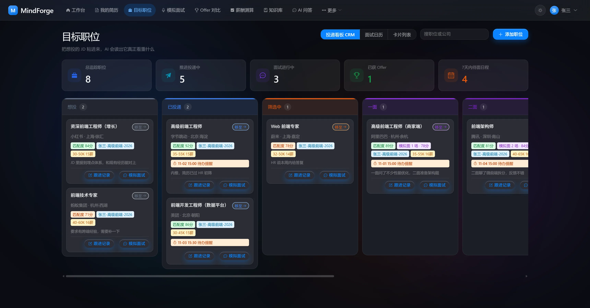

# MindForge AI（心铸智聘）

<p align="center">
  把整条求职链路收进一个工作台：简历、职位、面试、知识库，AI 参与每一步。
</p>

<p align="center">
  
  
  
  
  
  
  
</p>

---

## 为什么做这个

找工作这件事，信息散在十几个地方：简历在 Word 里，投递记录在表格里，JD 存在收藏夹，面试复盘写在备忘录，
真正想复习的技术点又散在浏览器标签页里。工具不是没有，但每一个只管一段——简历工具不管投递，
投递工具不管面试，面试工具不管你之前投过什么。

MindForge 把这些串成一条线：**简历解析出来的技能和项目，直接成为面试出题的素材；
投递到哪个岗位，面试就按那个岗位的 JD 出题；答错的题进错题本，下次重练；
你上传的技术文档进知识库，随时能对着问。** 各环节共享同一份数据，不用重复录入。

---

## 核心能力

<p align="center">
  
</p>

**简历**
上传 PDF / DOCX / TXT / Markdown / HTML，AI 抽成结构化字段（教育、经历、项目、技能）。
按目标 JD 给改写建议时，严格区分「表达可以更好」和「你确实缺这段经历」——后者不会替你编。
导出走服务端渲染，中文用 TTF 字体子集化，保证 ATS 能读出文字。

**职位与投递**
粘一条 JD 进来，AI 读出它真正看重什么，和你的简历做匹配分析。
投递用看板管，每张卡片带匹配度、关联的简历版本、薪资区间、下次跟进时间，到期邮件提醒。

<p align="center">
  
</p>

**模拟面试**
基于你的简历和某个具体 JD 出题，不是从题库里抽通用题。评分前先给定参考要点，避免模型自由发挥导致分数漂移。
结束后出复盘报告：技术深度、沟通表达、问题解决、工程规范、岗位契合五个维度，答错的题自动进错题本。

**知识库**
两条轨：官方公域（所有人共享的技术资料）和个人私域（自己上传的文档），检索时联合召回。
RAG 回答带引用来源，能点回原文。网页内容可以直接导入，不用先下载。

**平台能力**
双端 RBAC（用户端 / 管理端）、审计日志、接口限流、回收站（删错了能恢复）、
登录设备管理（看自己的账号在哪些设备上登着，踢掉可疑的）。

---

## 快速开始

项目由三个仓库组成，需要并列放在同一父目录。

| 仓库 | 负责什么 | 地址 |
| :--- | :--- | :--- |
| `mindforge-ai` | Java 后端 —— 业务数据、权限、流程编排 | 当前仓库 |
| `mindforge-ai-service` | Python AI 服务 —— 文档解析、向量化、RAG、模型调用 | [SunnyZest/mindforge-ai-service](https://github.com/SunnyZest/mindforge-ai-service) |
| `mindforge-web` | Vue 前端 —— 用户端与管理端（pnpm workspace 一仓两端） | [SunnyZest/mindforge-web](https://github.com/SunnyZest/mindforge-web) |

```bash
git clone https://github.com/SunnyZest/mindforge-ai-service.git
git clone https://github.com/SunnyZest/mindforge-web.git
```

```
mindforge-workspace/
├── mindforge-ai/            # Java 后端（本仓库）
├── mindforge-ai-service/    # Python AI 服务
└── mindforge-web/           # Vue 前端
```

> 三个目录必须并列 —— `docker-compose.yml` 里 Python 服务的构建上下文默认是
> `../mindforge-ai-service`，目录名或层级不同的话要改 `AI_SERVICE_PATH`。

### Docker Compose

```bash
cp .env.docker.example .env    # 填入密钥，缺哪项启动时会直接告诉你
docker compose up -d --build
```

起来之后访问 `http://localhost/`（用户端）和 `http://localhost/admin/`（管理端）。
建库脚本随仓库提供，首次启动自动完成建表与种子数据。

> **演示账号**：`admin` / `Admin@2026`（管理端）、`zhangsan` / `User@2026`（用户端）。
> 部署到公网前请改密码或删掉这两个账号。

### 本地开发

前置：JDK 21、Node 18+ 与 pnpm、Python 3.12、MySQL 8、Redis 7。

```bash
# 后端 :8080
mysql -uroot -p -e "CREATE DATABASE mindforge DEFAULT CHARACTER SET utf8mb4 COLLATE utf8mb4_0900_ai_ci;"
mysql -uroot -p mindforge < mindforge-schema.sql
./mvnw spring-boot:run

# AI 服务 :8000
cd mindforge-ai-service && uv sync
cp .env.example .env      # 填 JAVA_BASE_URL / JAVA_SERVICE_TOKEN / DASHSCOPE_API_KEY
.venv/Scripts/python.exe -m uvicorn app.main:app --port 8000 --reload

# 前端 :5173 / :5174
cd mindforge-web && corepack enable pnpm && pnpm install && pnpm dev:user
```

数据库和 JWT 密钥在 `src/main/resources/application-dev.yml`（已 gitignore，
参照 `application.yml` 的占位符自行创建）。前端的 `/api` 已在 `vite.config.ts` 里代理到 `:8080`，
本地不需要配 CORS。

---

## 架构

```
浏览器
  ├── 用户端 (Vue 3)   ─┐
  └── 管理端 (Vue 3)   ─┴─► Java 后端 (Spring Boot)
                                │  账号 / 权限 / 业务数据 / 流程编排
                                │
                                ├─► Python AI 服务 (FastAPI)
                                │     解析 / 分块 / 向量化 / RAG / 模型调用
                                │
                                ├─► MySQL     业务数据
                                ├─► Redis     限流 / 登录锁定 / Token 防重放
                                └─► Chroma    向量库
```

三条设计边界：

1. **数据权属在 Java，计算推理在 Python。** Python 不连数据库、不判权限，只做无状态计算。
   所有落库和鉴权都回 Java。
2. **用户端和管理端是两个权限空间。** URL 前缀不代表权限，实际由权限码拦截。
3. **内部接口只给 Python 调。** 走服务令牌，生产环境必须在网关层挡在公网外。

任务调度没有引入 MQ，用的是数据库悲观锁认领：`SELECT ... FOR UPDATE SKIP LOCKED`，
Python 侧 Pull 模式轮询。好处是少一个中间件、天然背压，代价是实时性差一点（秒级）。

---

## 技术栈

| 层 | 选型 |
| :--- | :--- |
| **后端** | Spring Boot 3.5 / Java 21 / Spring Security 6 / MyBatis-Plus / Druid |
| **AI 服务** | FastAPI / Python 3.12 / Chroma / DashScope（Qwen 对话 + Embedding + Rerank） |
| **前端** | Vue 3.5 / TypeScript / Vite 5 / Pinia / Element Plus / ECharts |
| **存储** | MySQL 8.0 / Redis 7 / 阿里云 OSS |
| **文档处理** | pdfplumber / pypdf / python-docx / trafilatura / RapidOCR |

前端依赖刻意停在市面主流档位而非最新大版本（Vite 5 而不是 6、Pinia 2 而不是 3），
新大版本的生态和文档还没跟上，踩坑概率高。版本以 `pom.xml` 和 `package.json` 为准。

---

## 项目结构

```
src/main/java/com/zest/mindforgeai/
├── controller/{user,admin,internal}   # 三个权限空间的接口
├── service/ + impl/                   # 业务逻辑
├── security/                          # JWT 过滤器、限流、权限
├── client/                            # 调 Python 的 HTTP 客户端
├── task/                              # 定时任务（清理、归档、提醒）
└── common/                            # 统一响应体、错误码、异常处理
```

---

## 测试

```bash
./mvnw test                                    # 后端
cd mindforge-ai-service && pytest tests/unit   # AI 服务
```

后端的接口测试起完整 Spring 上下文和真实 HTTP 服务（随机端口），走的是生产同一套过滤链，
不是 MockMvc 切片。外部依赖（AI 服务、对象存储、邮件）全部 mock，所以跑得快、不花钱、可重复。

---

## 当前限制

- **存储只实现了阿里云 OSS。** 配置里的 `LOCAL` / `MINIO` 是空选项，切过去会启动失败。
- **AI 接口都是同步慢接口。** 简历解析 10~40 秒，简历优化 100~200 秒，前端超时需要放宽到 5 分钟。
- **PDF 导出并发上限 4**（单实例信号量）。多实例部署时全局上限是 4 × 实例数。
- **踢掉设备后 access token 还有最多 30 分钟窗口。** JWT 无状态，撤销 refresh token 只能让下次刷新失败。
  要立即生效得加会话黑名单，当前没做。
- **仓库不含 HTTPS 配置。** Nginx 只监听 80，正式部署前必须自己加证书，否则密码和 Token 是明文传输。

---

## 文档

接口契约、错误码、部署手册在本地维护，不随仓库分发。
如果你是从 GitHub 看到这个项目的，需要细节可以直接开 Issue 问。

---

## License

[MIT](LICENSE)
