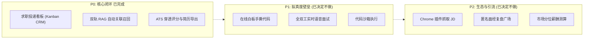

# MindForge AI（心铸智聘）

<p align="center">
  
  
  
  
  
  
  
  
  
  
</p>

<p align="center">
  面向求职者的 AI 求职工作台：简历解析与优化、职位匹配、模拟面试、投递看板、双轨 RAG 知识库。
</p>

---

## 这个项目是什么

一个**从简历上传到拿到 Offer 的完整闭环**，不是 Demo 拼盘：

- 简历传上来，AI 抽成结构化数据，再按目标 JD 给改写建议（严格区分「表达改写」和「缺失事实」——后者不替你编）；
- 职位投递用 8 列看板管，日程自动提醒，面试后写错题本；
- 模拟面试出题基于你的简历 + JD，报告按四维打分；
- 知识库分「官方公域」和「个人私域」两条轨，RAG 问答带引用来源。

技术上有两个刻意的取舍：**Java 管数据、Python 管计算**（Python 不直连数据库、不判权限），
以及**用数据库悲观锁认领任务替代 MQ**（`FOR UPDATE SKIP LOCKED`，Pull 模式，天然背压）。

---

## 目录

- [核心能力](#核心能力)
- [系统架构](#系统架构)
- [技术栈](#技术栈)
- [快速开始](#快速开始)
- [项目结构](#项目结构)
- [测试](#测试)
- [接口规模](#接口规模)
  - [SSE 流式对话契约](#sse-流式对话契约)
  - [局部更新的 null 语义](#局部更新的-null-语义)
- [关键工程约定](#关键工程约定)
- [已知边界](#已知边界)
- [路线图](#路线图)

---

## 核心能力

| 模块 | 能力 |
| :--- | :--- |
| **简历** | 上传（PDF/DOCX/TXT/MD/HTML）→ AI 结构化解析 → 按 JD 定向优化 → 在线精修 → **服务端渲染导出 PDF** |
| **简历匹配** | 五类具象结论（已匹配 / 表达缺口 / 证据不足 / 真实缺口 / 待确认），不用无意义的单一百分比 |
| **ATS 跑分** | 纯本地算法，毫秒级、零 token、同输入同结果，和上面的「匹配分析」是两回事 |
| **模拟面试** | 基于简历 + JD 动态出题，预置参考要点防打分漂移，四维复盘报告 + 错题本重练 |
| **投递管理** | 8 列 Kanban CRM（关联简历/薪资/下次跟进）+ 面试日历 + 邮件主动提醒 |
| **知识库** | 双轨 RAG（官方智库全局共享 + 个人私域联合召回）+ Rerank 精排 + SSE 流式对话 |
| **文档处理** | 多格式解析归一化、扫描件 OCR 双引擎降级、异步分块向量化 |
| **平台** | 双端 RBAC、审计日志、限流、回收站、AI 模型配置与「当前生效」可视化 |
| **登录安全** | 双 Token 轮转 + 重放检测、失败锁定、**登录设备管理**（看设备 / 踢可疑会话） |

---

## 系统架构

```
                              ┌────────────────────────────────────────┐
                              │            用户浏览器 Client            │
                              └───────┬────────────────────────┬───────┘
                                      │                        │
                    :5173 /           ▼                        ▼           :5174 /admin/
           ┌────────────────────────────────┐    ┌────────────────────────────────┐
           │   用户端前端 (User Portal)     │    │   管理端前端 (Admin Console)   │
           │   Vue 3 + TS + Element Plus    │    │   Vue 3 + TS + Element Plus    │
           └──────────────┬─────────────────┘    └────────────────┬───────────────┘
                          │                                       │
                          │   Vite Proxy: /api ──► :8080/api      │
                          └───────────────────┬───────────────────┘
                                              ▼
                    ┌──────────────────────────────────────────────────┐
                    │       Java 业务主后端 (Spring Boot 3.5.16)        │
                    │   • 账号鉴权与 RBAC (无状态双 Token 轮转安全防御)  │
                    │   • 知识库/文档元数据管理与预签名 OSS/MinIO 存取   │
                    │   • 对话会话状态机、简历与 JD 业务生命周期维护     │
                    │   • 面试流程编排、审计日志记录、限流与风控告警     │
                    └───────────▲──────────────────────────┬───────────┘
                                │                          │
                  分布式异步认领 │ FOR UPDATE               │ REST / SSE
         (POST /internal/claim) │ SKIP LOCKED              │ (带 X-Service-Token)
                                │                          ▼
                    ┌───────────┴──────────────────────────────────────┐
                    │         Python AI 微服务 (FastAPI / 3.12)        │
                    │   • 文档智能解析 (PDF/DOCX/TXT/MD/HTML 统一归一化)│
                    │   • 原生文本提取与爬虫清洗工具 (基于 trafilatura) │
                    │   • 文本智能分块 (Chunking) & 向量化嵌入管道     │
                    │   • SSE 逐字流式 RAG 对话                        │
                    │   • 阿里百炼 Qwen 系列 + Embedding + Rerank      │
                    └─────────────────────┬────────────────────────────┘
                                          │
            ┌─────────────────────────────┼─────────────────────────────┐
            ▼                             ▼                             ▼
   ┌─────────────────┐           ┌─────────────────┐           ┌─────────────────┐
   │    MySQL 8.0    │           │     Redis 7     │           │   对象存储/向量库 │
   │ 业务实体持久化  │           │ Token黑名单防重放│           │ OSS(已实现)     │
   │ 乐观锁与状态机  │           │ 滑动窗口接口限流 │           │ MinIO(未实现)   │
   └─────────────────┘           └─────────────────┘           └─────────────────┘
```

> **MinIO 是规划中的存储后端**：`docker-compose.yml` 已编排 `minio` / `minio-init`，
> 但 Java 侧目前只实现了阿里云 OSS（`FileStorageService` 仅 `OssFileStorageServiceImpl` 一个实现）。
> `StorageProperties` 注释里的 `LOCAL` / `MINIO` 尚未落地，切过去会因注入不到实现而启动失败。

**三条硬边界**

1. **数据权属在 Java，计算推理在 Python。** Python 不直连数据库、不判权限，只做无状态计算。
2. **`/api/app/**` 与 `/api/admin/**` 是两个权限空间**，URL 前缀不代表权限，实际由权限码拦截。
3. **内部接口 `/internal/**` 只给 Python 调**，走 `X-Service-Token`，生产必须在网关层挡在公网外。

---

## 技术栈

| 层 | 技术 | 说明 |
| :--- | :--- | :--- |
| **Java 业务端** | Spring Boot 3.5.16 / Java 21 | Spring Security 6 + JJWT 0.12（双 Token 轮转） |
| | MyBatis-Plus 3.5.16 + Druid | 33 张表，主键全为雪花 ID，无一张用自增 |
| | MySQL 8.0 + Redis 7 | 限流与登录锁定走 Redis（要跨实例共享，不能用本地缓存） |
| | Knife4j / SpringDoc | OpenAPI 3 契约（生产环境关闭） |
| | openhtmltopdf + Thymeleaf | 简历 PDF 服务端渲染 |
| **Python AI 端** | FastAPI + Uvicorn（Python 3.12） | 异步 ASGI，无 LangChain 依赖，秒级启动 |
| | DashScope 阿里百炼 | Qwen 对话 + `text-embedding-v1` 嵌入 + gte-rerank 精排 |
| | pdfplumber / pypdf / python-docx / trafilatura | 文档解析与网页清洗 |
| | qwen-vl-ocr → RapidOCR | 扫描件双引擎降级 |
| | Chroma | 向量库（进程内，随服务持久化） |
| **前端** | Vue 3.5 + TypeScript 5.8 + Vite 5 | pnpm workspace 一仓两端 |
| | Pinia 2 + Vue Router 4 | HTML5 History 路由 |
| | Element Plus 2.7 + ECharts 6 | 按需自动引入 |

> **版本以 `pom.xml` / `package.json` 为准。** 前端依赖刻意停在**市面主流档位**而不是最新大版本
> （Vite 5 而非 6、Pinia 2 而非 3、vue-router 4 而非 5）—— 新大版本的生态和文档还没跟上，踩坑概率高。

---

## 快速开始

项目由**三个仓库**组成，需要并列放在同一父目录：

```
mindforge-workspace/
├── mindforge-ai/            # Java 后端（本仓库）
├── mindforge-ai-service/    # Python AI 服务
└── mindforge/               # Vue 前端 monorepo（用户端 + 管理端）
```

### 方式一：Docker Compose（最快）

```bash
cp .env.docker.example .env      # 填入所有密钥（未填会启动失败并提示缺哪个）
docker compose up -d --build
```

起来之后：用户端 `http://localhost/`，管理端 `http://localhost/admin/`，后端只在容器内网可达。

建库脚本 `mindforge-schema.sql` 已随仓库提供，compose 会自动挂进 MySQL 的初始化目录，
首次启动即完成建表 + 种子数据。

> **默认账号**（写在种子数据里，建完库就能直接登录）
>
> | 账号 | 密码 | 角色 | 入口 |
> | :--- | :--- | :--- | :--- |
> | `admin` | `Admin@2026` | 超级管理员 | `/admin/` |
> | `zhangsan` | `User@2026` | 普通用户 | `/` |
>
> ⚠️ **部署到公网前必须改密码或删掉这两个账号** —— 密码是公开的。

### 方式二：本地开发（三个终端）

前置：JDK 21、Node 18+ 与 pnpm、Python 3.12、MySQL 8、Redis 7。

```bash
# 终端 1：Java 后端（:8080，context-path 是 /api）
cd mindforge-ai
mysql -uroot -p -e "CREATE DATABASE mindforge DEFAULT CHARACTER SET utf8mb4 COLLATE utf8mb4_0900_ai_ci;"
mysql -uroot -p mindforge < mindforge-schema.sql   # 33 张表 + 角色权限 + 两个演示账号
./mvnw spring-boot:run

# 终端 2：Python AI 服务（:8000）
cd mindforge-ai-service
uv venv --python 3.12 && uv sync        # 依赖在 pyproject.toml，没有 requirements.txt
cp .env.example .env                    # 填 JAVA_BASE_URL / JAVA_SERVICE_TOKEN / DASHSCOPE_API_KEY
.venv/Scripts/python.exe -m uvicorn app.main:app --port 8000 --reload

# 终端 3：前端（用户端 :5173 / 管理端 :5174）
cd mindforge
corepack enable pnpm && pnpm install
pnpm dev:user      # 或 pnpm dev:admin
```

配置细节：

- **数据库 / Redis / JWT 密钥**在 `src/main/resources/application-dev.yml`（该文件已 gitignore，
  参照 `application.yml` 里的占位符自行创建）。
- **前端 `/api` 请求**已在各自的 `vite.config.ts` 里代理到 `:8080`，本地开发不需要配 CORS。
- **验证 Python ↔ Java 连通**：访问 `http://localhost:8000/health/java`，返回 `{"status":"ok"}` 即握手成功。

---

## 项目结构

```
src/main/java/com/zest/mindforgeai/
├── controller/
│   ├── user/            # 用户端接口（/app/**）
│   ├── admin/           # 管理端接口（/admin/**）
│   └── internal/        # 内部接口（/internal/**，只给 Python 调）
├── service/ + impl/     # 业务逻辑
├── mapper/              # MyBatis-Plus Mapper
├── pojo/{entity,dto,vo} # 实体 / 入参 / 出参
├── config/              # 安全、Jackson、存储、线程池等配置
├── security/            # JWT 过滤器、限流、权限
├── task/                # 定时任务（清理、归档、提醒）
├── client/              # 调 Python 的 HTTP 客户端
└── common/              # 统一响应体、错误码、异常处理

src/main/resources/
├── templates/resume/    # 简历 PDF 模板（Thymeleaf，XML 模式）
├── fonts/               # 中文字体（随 jar 打包，不依赖宿主机）
└── mapper/              # MyBatis XML
```

---

## 测试

```bash
./mvnw test                        # Java：576 条
cd mindforge-ai-service && pytest tests/unit    # Python：227 条
```

Java 侧的接口测试**起完整 Spring 上下文 + 真实 HTTP**（随机端口），走的是生产同一套过滤链
（JWT、RBAC、参数校验、异常处理），不是 MockMvc 切片 —— 几个真 bug 只在完整链路下才会暴露。
外部依赖（AI 服务、对象存储、邮件通道）全部 mock，所以秒级、免费、可重复。

> 跑 Java 测试前需要有 `mindforge_test` 库和 Redis。建库脚本与主库相同，
> 但要把 `mindforge-schema.sql` 里的 `CREATE DATABASE` / `USE` 两句滤掉。

---

## 接口规模

| 维度 | 数量 |
| :--- | :--- |
| HTTP 端点 | **162**（用户端 92 / 管理端 62 / 内部 8） |
| 数据库表 / 实体 | **33 / 30**（3 张归档表无实体，走 JdbcTemplate） |
| 权限码 | **59**（用户端 31 / 管理端 28），角色 3 个 |
| 业务错误码 | **44**（含 `0` 成功） |
| 自动化测试 | **Java 594 条 / Python 239 条**（全绿，另 2 条 skip；Java 侧起完整 Spring 上下文 + 真实 HTTP，走的是生产同一套过滤链：JWT、RBAC、参数校验、异常处理） |

统一响应体 `{code, message, data, traceId}`，`code = 0` 为成功；HTTP 状态码由 `code / 100` 推出。

> 逐端点的路径、权限码、返回类型与完整错误码表，见 API 开发文档
> `MindForge-AI-API开发文档-双前端单后端-RBAC.md`（本地维护，不进版本库）。

**两个特殊接口**：

- `POST /api/app/conversations/{id}/messages/stream` —— SSE 流式对话，事件格式见下。
- `GET /api/app/resumes/{id}/export` —— 返回 `application/pdf` 二进制流，
  是全项目唯一不走统一信封的接口（前端必须用 `responseType: 'blob'`）。

### SSE 流式对话契约

```
event: sources   data: {"type":"sources","sources":[...],"hasContext":true}
event: delta     data: {"type":"delta","text":"Java "}
event: delta     data: {"type":"delta","text":"内存模型"}
event: done      data: {"type":"done","answer":"...","hasAnswer":true}
event: error     data: {"type":"error","code":50202,"message":"..."}
```

- **`done` 与 `error` 只会来一个**。收到 `error` 就不要再等 `done`，否则前端会一直转圈。
- 每个事件的 `data` 都是**完整 JSON**，不要在客户端写增量 JSON 解析器。
- `sources` 先于 `delta` 下发，所以引用来源可以先渲染出来。

### 局部更新的 `null` 语义

所有 `*UpdateDTO` 都是**「传了才改」**：字段为 `null` 表示「保持原值」，**不表示清空**。

| 想做的事 | 正确做法 |
| :--- | :--- |
| 把某列写成 `NULL` | 额外给一个显式布尔标志（如 `clearNextActionAt`），因为「没传」和「显式传 null」反序列化后无法区分 |
| 解除字符串型关联 | 传**空串** `""`（如 `linkedResumeId: ""`），非空才是「不修改」 |
| 后端实现 | 必须用 `LambdaUpdateWrapper.set(field, null)`；MyBatis-Plus 的 `updateById` 会静默忽略 `null` 字段 |

`nextActionAt` 与 `clearNextActionAt` 同时出现时 **`nextActionAt` 优先** ——
前端因此可以「总是带上 `clearNextActionAt`」，不必自己判断有没有改过。

---

## 关键工程约定

这些是踩过坑之后定下来的规则，改动相关代码前值得先看：

| 约定 | 原因 |
| :--- | :--- |
| **雪花 ID 序列化成 String** | 64 位 Long 超过 JS `Number.MAX_SAFE_INTEGER`，直接传会末位漂移 |
| **可空上下文禁用 `Map.of()`** | 不可变 Map 的 `get(null)` 直接抛 NPE；用 `Collections.emptyMap()` |
| **SSE 要放行 `DispatcherType.ASYNC`** | 否则流收尾时被安全过滤器拦截，客户端收到虚假断连 |
| **双端 Token 前缀隔离** | 同源部署下 LocalStorage 共享，不加 `mf_user_` / `mf_admin_` 前缀会互相顶号 |
| **PDF 字体必须 TTF（TrueType 轮廓）** | CFF 轮廓的 OTF 能生成 PDF、人眼看正常，但提取的中文全是 `#`，ATS 读不出字 |
| **PDF 模板里拉丁字体排在中文前** | 思源黑体把 U+0020 与 U+00A0 映射到同一字形，子集化后所有空格变 NBSP |
| **超时预算：客户端 > 服务端最坏耗时** | 反了的话服务端的错误传不回来，客户端只看到「超时」 |
| **refresh token 作废要记原因** | 只有「轮转」才算泄露并撤销全部会话；登出/被踢只是拒绝这一次，否则踢别的设备会把自己也踢下线 |

---

## 已知边界

诚实地列出来，免得有人踩：

- **只有 OSS 存储实现**。`LOCAL` / `MINIO` 是空选项，改了会启动失败。
- **AI 接口全是同步慢接口**。简历解析 10~40 秒、优化 100~200 秒，前端超时必须放宽到 5 分钟。
- **PDF 导出并发上限 4**（单实例信号量），多实例部署时全局上限是 4 × 实例数。
- **踢设备后 access token 还有 ≤30 分钟窗口**。JWT 无状态，撤销 refresh token 只能让下一次刷新失败；
  要立刻生效得加会话黑名单（每次请求查一次 Redis），一期没做。
- **没有 HTTPS 配置**。`deploy/nginx/nginx.conf` 只监听 80，443 在 compose 里是注释掉的 ——
  正式部署前必须自己加证书，否则密码和 Token 是明文传输。

---

## 路线图



**2026-10-30 范围收敛**：P1 / P2 里的 5 项（代码靶场、语音面试、官方题库、面经广场、Chrome 插件）
**已明确不做**，虚线只是为了记录「考虑过什么」：

- **代码靶场**是安全边界 —— 不可信代码执行做不好就是给自己开后门，工程量约等于现有整个项目；
- **语音面试**本地 ASR 要 4~8G 内存，云 API 按秒计费；
- **面经广场**的难点是 UGC 合规与运营，不是技术；
- **Chrome 插件**是独立工程，跨域与登录态要另做一套，收益最低。

保留的只有 **MinIO / LOCAL 存储实现** —— 那不是加功能，是修「文档说有、代码没有」的不一致。

---

## 开源协议

本项目基于 [MIT License](LICENSE) 发布，欢迎 Issue 与 PR。
